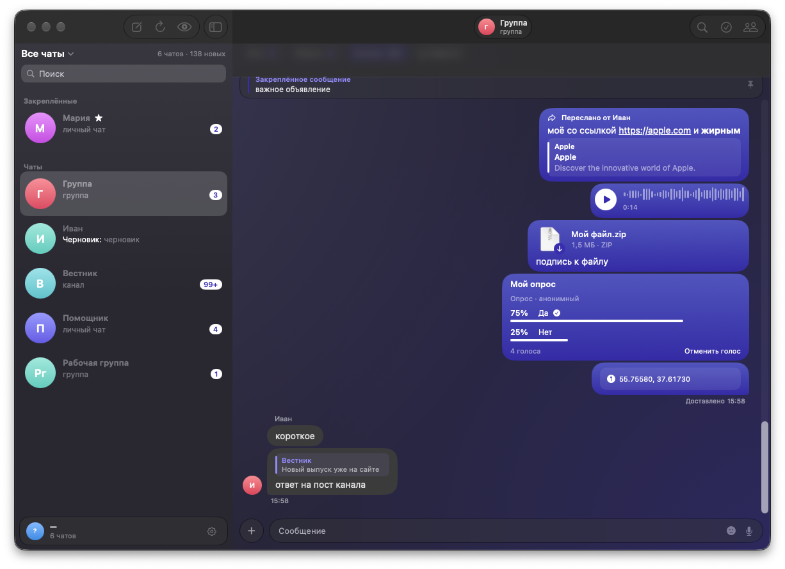

<p align="center">
  
</p>

<h1 align="center">Easy</h1>

<p align="center">
  A native Telegram client for the Mac.<br>
  SwiftUI on top of TDLib, Liquid Glass, several accounts at once, and a few things the official app does not do.
</p>

<p align="center">
  
</p>

> Easy is an unofficial client. It is not affiliated with or endorsed by Telegram.

## What it does

**Accounts**

- Every account you sign in to stays connected: messages, banners and unread counts arrive for all of them.
- One list can hold the chats of all accounts. A chat opens in the account it belongs to, so the answer goes
  from the right one without switching first.
- The other accounts sit at the foot of the sidebar with their unread counts, one click or `⌃1`…`⌃9` away.

**Chats**

- Messages-style bubbles, albums, stickers (static, animated and video), voice messages, polls, locations,
  forum topics, pinned messages, scheduled messages, reactions, translation.
- A chat with unread messages opens on the first of them.
- Mini apps open in their own window.
- Gifts for Telegram Stars from a person's profile, and your Stars balance.

**Ghost mode and memory**

- Ghost mode: not online, not typing, nothing marked as read.
- Messages other people delete and earlier versions of edited ones are kept on this Mac.

**Security tools**

- Links are checked before they open: punycode and mixed alphabets, an IP in place of a domain, shorteners,
  a link whose text names another site.
- A warning before an executable or a disguised file opens; SHA-256 of any attachment.
- Indicators of compromise pulled out of a message or a selection — URLs, domains, IPs, hashes, CVEs,
  wallets, ATT&CK techniques — as a defanged report, JSON or CSV.
- An account check-up: two-step verification, privacy settings open to everyone, stale and third-party
  sessions, a pending password reset, sites signed in to with Telegram.
- A passcode that locks the app and encrypts the Telegram database and the local archive, with Touch ID.

**Look**

- Liquid Glass on macOS 26, the closest material before it.
- Its own indigo, or the colour of your desktop picture.
- Light and dark.

## Requirements

- macOS 15 or later, Apple Silicon.
- Your own `api_id` and `api_hash` from [my.telegram.org](https://my.telegram.org) → API development tools.
  Easy asks for them on first launch and keeps them in its sandbox container, readable only by you.

## Building

Easy is a Swift package; it needs Xcode's command line tools and TDLib 1.8.67, which is not kept in this
repository. [`vendor/README.md`](vendor/README.md) names the exact TDLib revision and how it is built into
`vendor/tdlib`.

```bash
./build.sh
```

This produces `build/Easy.app`: the binary, TDLib and Lottie bundled in, sandboxed, signed ad hoc.

```bash
./make-dmg.sh
```

This packs the app into `build/Easy-<version>.dmg` and checks the image the way the Mac it lands on would.
The app is signed ad hoc, not notarised: on another Mac it has to be opened once through
System Settings → Privacy & Security → "Open Anyway".

## Tests

```bash
Harness/run.sh
```

Five stands compile the app's own sources next to a test `main.swift`: model logic, the TDLib session
lifecycle (including a second account), the interface, mini apps, and scrolling. They keep their data under
`Harness/.work` and stop if anything could reach the real app folders.

## Layout

| Path | What is there |
| --- | --- |
| `Sources/SwiftLite/App` | The app's scenes and menus |
| `Sources/SwiftLite/Store` | `AppModel` (one Telegram session) and `AccountHub` (all of them) |
| `Sources/SwiftLite/TDLib` | The bridge to TDLib's JSON interface and the models read from it |
| `Sources/SwiftLite/UI` | SwiftUI views |
| `Sources/SwiftLite/Support` | Preferences, the passcode, notifications, security tools, audio |
| `Harness` | Test stands |
| `tools` | Icon generator, bundle checks, relaunch script |

## Privacy

Easy talks to Telegram's servers through TDLib; mini apps load their own pages, and nothing is sent anywhere
else. It runs in the macOS App
Sandbox with network access, the microphone while a voice message records, files you pick or drop, and the
Downloads folder.
